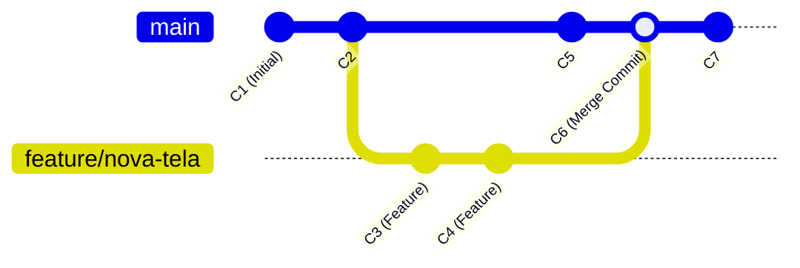

# 🚀 Dominando Git e GitHub: Guia Completo e Prático

<div align="center">


<p align="center">
  <b>Repositório de estudos e manual prático de referência rápida de Versionamento com Git e colaboração no GitHub.</b><br>
  <i>Baseado nas aulas e na live do curso oficial do Professor Gustavo Guanabara (<a href="https://www.cursoemvideo.com/">Curso em Vídeo</a>).</i>
</p>

</div>

---

## 📑 Tabela de Conteúdos

- [Visão Geral](#-visão-geral)
- [Git vs. GitHub: Diferenças Fundamentais](#-git-vs-github-diferenças-fundamentais)
- [Arquitetura e Ciclo de Vida dos Arquivos](#-arquitetura-e-ciclo-de-vida-dos-arquivos)
- [Configuração Inicial do Ambiente](#-configuração-inicial-do-ambiente)
- [Cheat Sheet: Comandos Essenciais](#-cheat-sheet-comandos-essenciais)
  - [1. Inicialização e Clonagem](#1-inicialização-e-clonagem)
  - [2. Fluxo Diário de Trabalho](#2-fluxo-diário-de-trabalho)
  - [3. Histórico e Comparações](#3-histórico-e-comparações)
  - [4. Ramificações (Branches) e Mesclagem (Merge)](#4-ramificações-branches-e-mesclagem-merge)
  - [5. Sincronização com Repositório Remoto](#5-sincronização-com-repositório-remoto)
  - [6. Desfazendo Alterações e Correções de Erros](#6-desfazendo-alterações-e-correções-de-erros)
- [O Arquivo `.gitignore`](#-o-arquivo-gitignore)
- [Manual de Markdown para o GitHub](#-manual-de-markdown-para-o-github)
- [Boas Práticas: Conventional Commits](#-boas-práticas-conventional-commits)
- [GitHub Pages e Hospedagem Gratuita](#-github-pages-e-hospedagem-gratuita)
- [Colaboração Open-Source: Forks e Pull Requests](#-colaboração-open-source-forks-e-pull-requests)
- [Créditos e Referências](#-créditos-e-referências)

---

## 🎯 Visão Geral

Este repositório consolida os fundamentos essenciais de versionamento de código, rastreamento de mudanças e trabalho colaborativo ensinados pelo professor Gustavo Guanabara. O objetivo é servir como uma fonte de consulta imediata para desenvolvedores de qualquer nível técnico.

---

## ⚖️ Git vs. GitHub: Diferenças Fundamentais

| Característica | Git | GitHub |
| :--- | :--- | :--- |
| **Definição** | Sistema de Controle de Versões Distribuído (DVCS). | Plataforma na nuvem para hospedagem de repositórios Git. |
| **Execução** | Opera localmente na máquina do desenvolvedor (via CLI ou GUI). | Opera em servidores remotos através da web. |
| **Conexão** | Não requer internet para criar commits, branches ou logs. | Requer internet para sincronização e acesso a serviços remotos. |
| **Propósito** | Rastrear o histórico temporal e variações de código-fonte. | Facilitar colaboração em equipe, hospedagem, CI/CD e revisão de código. |
| **Criação** | Desenvolvido por Linus Torvalds em 2005. | Lançado em 2008 (atualmente pertencente à Microsoft). |

---

## 🔄 Arquitetura e Ciclo de Vida dos Arquivos

O Git divide o fluxo de trabalho em **4 áreas principais**:

1. **Working Directory (Diretório de Trabalho):** Onde você cria, edita e apaga arquivos no seu computador.
2. **Staging Area / Index (Área de Preparação):** Onde você seleciona quais alterações entrarão no próximo commit (`git add`).
3. **Local Repository (Repositório Local):** O histórico de commits salvo na sua máquina dentro da pasta oculta `.git` (`git commit`).
4. **Remote Repository (Repositório Remoto):** A versão hospedada na nuvem, no GitHub (`git push` / `git pull`).

### Estados de um Arquivo no Git:
1. **Untracked (Não rastreado):** Arquivo novo que o Git ainda não monitora.
2. **Modified (Modificado):** Arquivo já monitorado que sofreu alterações no diretório de trabalho.
3. **Staged (Preparado):** Arquivo selecionado e pronto para ser gravado no próximo commit.
4. **Committed (Consolidado):** Dados gravados permanentemente no banco de dados local do Git (`.git`).

---

## ⚙️ Configuração Inicial do Ambiente

Após instalar o Git, o primeiro passo obrigatório é definir a identidade do desenvolvedor:

```bash
# Definir nome de usuário global
git config --global user.name "Seu Nome Completo"

# Definir email associado à sua conta do GitHub
git config --global user.email "seu-email@dominio.com"

# Definir a branch padrão inicial como 'main'
git config --global init.defaultBranch main

# Configurar o editor de texto padrão (exemplo: VS Code)
git config --global core.editor "code --wait"

# Listar todas as configurações ativas
git config --list
```

### Autenticação Moderna no GitHub:
> [!NOTE]
> O GitHub não aceita mais senhas convencionais de conta para operações via linha de comando (`git push`).

- **Opção 1 (Recomendada): Chave SSH**
  ```bash
  ssh-keygen -t ed25519 -C "seu-email@dominio.com"
  cat ~/.ssh/id_ed25519.pub
  ```
  *Cole a chave pública em: **GitHub > Settings > SSH and GPG keys > New SSH Key**.*
- **Opção 2: Personal Access Token (PAT)**
  *Gere o token em: **GitHub > Settings > Developer Settings > Personal Access Tokens > Tokens (classic)**.*

---

## 🛠️ Cheat Sheet: Comandos Essenciais

### 1. Inicialização e Clonagem

| Comando | Descrição |
| :--- | :--- |
| `git init` | Transforma o diretório atual em um repositório Git local (cria pasta oculta `.git`). |
| `git clone <URL>` | Clona um repositório remoto inteiro para sua máquina local. |

### 2. Fluxo Diário de Trabalho

| Comando | Descrição |
| :--- | :--- |
| `git status` | Exibe o estado dos arquivos (modificados, preparados, não monitorados). |
| `git add <arquivo>` | Adiciona um arquivo específico à Staging Area. |
| `git add .` | Adiciona todas as modificações do diretório atual e subdiretórios à Staging Area. |
| `git commit -m "mensagem"` | Grava as alterações preparadas no repositório com uma mensagem explicativa. |
| `git commit -am "mensagem"` | Atalho que prepara (`git add`) e commita arquivos já monitorados em uma só instrução. |

### 3. Histórico e Comparações

| Comando | Descrição |
| :--- | :--- |
| `git log` | Exibe o histórico detalhado de commits (autor, data, hash, mensagem). |
| `git log --oneline` | Exibe o histórico de forma compacta (um commit por linha). |
| `git log --graph --all --decorate --oneline` | Exibe a árvore visual de branches e commits de forma gráfica no terminal. |
| `git diff` | Mostra as alterações feitas no Working Directory que ainda não foram enviadas para o Stage. |
| `git diff --staged` | Mostra as diferenças entre o que está no Stage e o último commit efetuado. |
| `git show <hash_do_commit>` | Exibe detalhes e código alterado em um commit específico. |

### 4. Ramificações (Branches) e Mesclagem (Merge)

As *branches* permitem desenvolver novas funcionalidades ou corrigir bugs em ambientes isolados sem impactar o código principal (`main` ou `master`).



| Comando | Descrição |
| :--- | :--- |
| `git branch` | Lista todas as branches locais e indica qual está ativa. |
| `git branch <nome-da-branch>` | Cria uma nova branch a partir do ponto atual. |
| `git checkout <nome-da-branch>` | Alterna para a branch especificada. |
| `git switch <nome-da-branch>` | Alternativa moderna e focada para alternar de branch. |
| `git checkout -b <nova-branch>` | Cria a nova branch e já alterna para ela em uma única etapa. |
| `git switch -c <nova-branch>` | Equivalente moderno ao `checkout -b`. |
| `git merge <nome-da-branch>` | Mescla as alterações da branch informada dentro da branch atual. |
| `git branch -d <nome-da-branch>` | Remove com segurança uma branch local já mesclada. |
| `git branch -D <nome-da-branch>` | Força a exclusão de uma branch local mesmo sem mesclagem prévia. |

> [!WARNING]
> Em caso de **conflito de merge**, o Git marcará os arquivos afetados com `<<<<<<<`, `=======` e `>>>>>>>`. Abra os arquivos, decida qual versão manter, remova as marcações, adicione com `git add .` e finalize com `git commit`.

### 5. Sincronização com Repositório Remoto

| Comando | Descrição |
| :--- | :--- |
| `git remote add origin <URL>` | Associa o repositório local a um repositório remoto chamado `origin`. |
| `git remote -v` | Lista os endereços dos repositórios remotos configurados (fetch e push). |
| `git push -u origin main` | Envia os commits locais para o servidor remoto e configura a relação upstream. |
| `git push` | Envia novos commits para a branch rastreada configurada. |
| `git fetch origin` | Busca informações e commits novos do servidor sem alterar seus arquivos locais. |
| `git pull origin main` | Baixa os novos commits remotos e mescla automaticamente na sua branch atual (`fetch + merge`). |

### 6. Desfazendo Alterações e Correções de Erros

| Situação | Comando Recomendado | O que acontece |
| :--- | :--- | :--- |
| Descartar mudanças não salvas no Working Directory | `git restore <arquivo>` | Restaura o arquivo ao estado do último commit. |
| Tirar um arquivo da Staging Area (Unstage) | `git restore --staged <arquivo>` | Mantém as alterações, mas retira o arquivo da fila de commit. |
| Corrigir a mensagem do último commit realizado | `git commit --amend -m "nova mensagem"` | Reescreve a mensagem do último commit local. |
| Desfazer o último commit mantendo os arquivos no Stage | `git reset --soft HEAD~1` | O commit é desfeito, mas o código continua preparado. |
| Desfazer o último commit mantendo os arquivos modificados | `git reset --mixed HEAD~1` | O commit é desfeito e os arquivos voltam para modificados. |
| Descartar commit e todas as alterações permanentemente | `git reset --hard HEAD~1` | **Cuidado:** Apaga permanentemente tudo que foi feito no commit. |
| Reverter um commit público com segurança | `git revert <hash_do_commit>` | Cria um novo commit invertendo as alterações do commit anterior. |

---

## 🚫 O Arquivo `.gitignore`

O `.gitignore` instrui o Git a ignorar arquivos que não devem ser rastreados (arquivos temporários, dependências volumosas, variáveis de ambiente e arquivos confidenciais).

### Exemplo Prático de `.gitignore`:

```gitignore
# Arquivos de Sistema Operacional
.DS_Store
Thumbs.db
desktop.ini

# Variáveis de ambiente e credenciais (NUNCA versione arquivos .env!)
.env
.env.local
*.pem
*.key

# Dependências de Projetos
node_modules/
vendor/
venv/
__pycache__/

# Logs e arquivos de depuração
*.log
npm-debug.log*
yarn-debug.log*

# Configurações de IDEs locais
.vscode/
.idea/
*.suo
*.user
```

---

## 📝 Manual de Markdown para o GitHub

O Markdown é a linguagem padrão utilizada para formatar arquivos de documentação (`README.md`), *Issues* e *Pull Requests*.

### Guia Rápido de Sintaxe:

```markdown
# Título 1 (Heading 1)
## Título 2 (Heading 2)
### Título 3 (Heading 3)

**Texto em Negrito** ou __Negrito__
*Texto em Itálico* ou _Itálico_
~~Texto Tachado / Riscado~~

> Bloco de citação de destaque.

- Item não ordenado 1
- Item não ordenado 2
  - Subitem indentado

1. Primeiro passo
2. Segundo passo
3. Terceiro passo

- [x] Tarefa concluída
- [ ] Tarefa pendente

[Texto do Link](https://github.com)


`codigo_em_linha`
```

---

## 🏷️ Boas Práticas: Conventional Commits

Manter mensagens de commit claras e padronizadas facilita a leitura do histórico e a automação de releases.

| Prefixo | Significado | Exemplo |
| :--- | :--- | :--- |
| `feat:` | Uma nova funcionalidade adicionada ao projeto | `feat: adicionar autenticação via OAuth2` |
| `fix:` | Correção de um bug ou erro no código | `fix: corrigir cálculo de desconto no checkout` |
| `docs:` | Mudanças exclusivamente na documentação | `docs: atualizar manual de comandos no README` |
| `style:` | Alterações visuais/formatação que não alteram lógica | `style: aplicar indentação e remover ponto e vírgula` |
| `refactor:` | Refatoração de código sem alterar comportamento | `refactor: simplificar função de validação de CPF` |
| `test:` | Adição ou ajuste de testes automatizados | `test: criar testes unitários para a classe de usuário` |
| `chore:` | Tarefas rotineiras, dependências ou ferramentas de build | `chore: atualizar versão do pacote react para 18.2` |

---

## 🌐 GitHub Pages e Hospedagem Gratuita

O GitHub Pages permite hospedar sites estáticos (HTML, CSS e JavaScript) diretamente a partir de um repositório público:

1. Acesse o seu repositório no GitHub.
2. Clique na aba **Settings** (Configurações).
3. Na barra lateral esquerda, clique em **Pages**.
4. Em **Build and deployment > Source**, selecione **Deploy from a branch**.
5. Escolha a branch (geralmente `main` ou `master`) e a pasta raiz (`/ (root)` ou `/docs`).
6. Clique em **Save**.
7. O endereço público ficará acessível em: `https://<seu-usuario>.github.io/<nome-do-repositorio>/`.

---

## 🤝 Colaboração Open-Source: Forks e Pull Requests

O fluxo padrão de contribuição para projetos de terceiros segue estes 5 passos:

1. **Fork:** No GitHub, clique no botão **Fork** (canto superior direito) do repositório original para criar uma cópia em sua conta.
2. **Clone:** Clone o seu fork para a sua máquina local:
   ```bash
   git clone [https://github.com/Tonjr12/git-github.git](https://github.com/Tonjr12/git-github.git)
   ```
3. **Branch:** Crie uma branch específica para sua contribuição:
   ```bash
   git checkout -b feature/minha-melhoria
   ```
4. **Commit & Push:** Faça suas melhorias, comite e suba para o seu fork:
   ```bash
   git add .
   git commit -m "feat: adicionar documentação detalhada de comandos"
   git push -u origin feature/minha-melhoria
   ```
5. **Pull Request (PR):** Vá até a página do repositório no GitHub, clique em **Compare & pull request**, descreva o que foi feito e envie para revisão do proprietário do projeto original.

---

## 👨‍🏫 Créditos e Referências

Este material foi compilado e estruturado a partir dos ensinamentos de:

- **Professor Gustavo Guanabara** — [Canal Curso em Vídeo no YouTube](https://www.youtube.com/c/CursoemV%C3%ADdeo)
- **Curso Oficial de Git e GitHub:** [Playlist no YouTube](https://www.youtube.com/playlist?list=PLHz_AreHm4dm7ZULPAmadvNhH6vk9oNZA)
- **Repositório Base Original:** [gustavoguanabara/git-github](https://github.com/gustavoguanabara/git-github)
- **Plataforma Oficial:** [Curso em Vídeo](https://www.cursoemvideo.com/)

---

<div align="center">
  Desenvolvido por <b>Tonjr12</b> 💻🚀
</div>